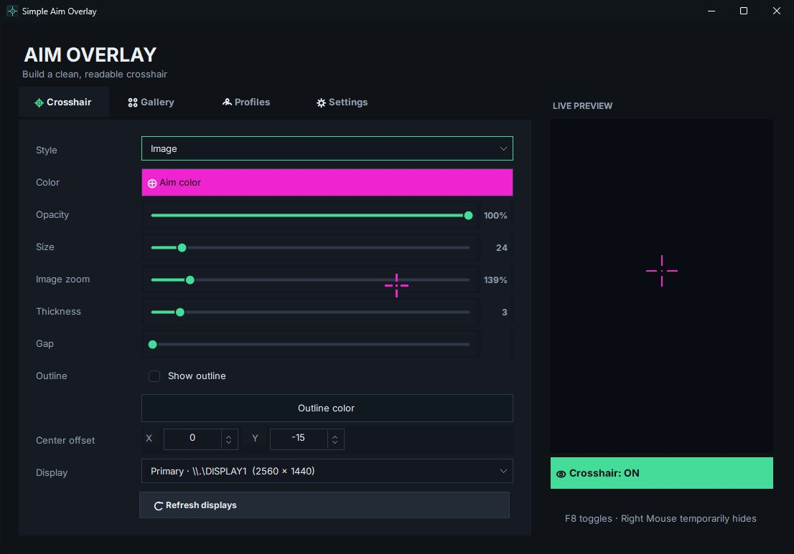
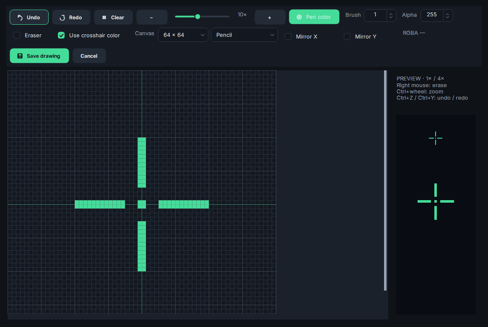
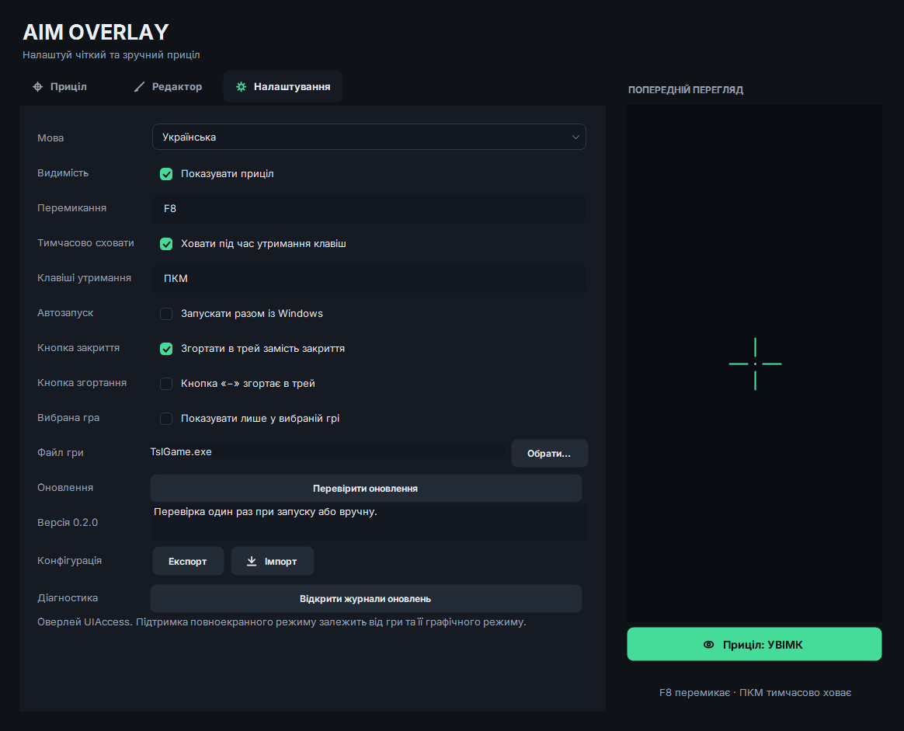
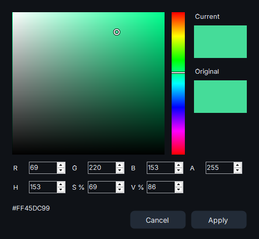

# Simple Aim Overlay

A customizable crosshair for **Windows 10/11, 64-bit**. English and Ukrainian. No account required.

**[Download 0.2.1 — Windows installer](https://github.com/vvoldi/SimpleAimOverlay/releases/download/v0.2.1/SimpleAimOverlay-0.2.1-Setup.exe)** · [All releases](https://github.com/vvoldi/SimpleAimOverlay/releases)

## Install & update

Run the EXE and approve the administrator prompt. On first installation, setup adds this project's **self-signed certificate** to your PC's trusted stores. Only install if you trust the source; Windows may show an unknown-publisher warning.

Updates are checked **once at launch**, or manually in **Settings → Check for updates**. Your settings and drawings are kept; the updater also saves a configuration backup before installation. Exit the app through its tray menu before a manual update.

## Make it yours

- **Crosshair:** standard styles, color, opacity, size, 0.1px thickness steps, gap, outline width/opacity, center offset and monitor selection.
- **Editor:** pencil, shapes, fill and symmetry. **Ctrl + wheel** zooms; **Ctrl + Z / Y** undo and redo. Double-click a saved drawing to edit it.
- **Share:** import/export drawings as **.aim** (includes color mode) or **PNG**. **Settings → Configuration** transfers settings and drawings together.
- **Keys:** **F8** toggles visibility; hold **Right Mouse** to hide temporarily. Click either binding in Settings to record up to three keys, including mouse buttons.
- **Selected game:** **Show only in the selected game** hides the crosshair outside the active game, including after Alt+Tab. It also starts the app when the game launches, using a background watcher at Windows sign-in. PUBG is the default; choose another game with **Browse**.
- **Settings:** English / Українська, Windows startup, and closing/minimizing to the tray. Choose **Exit** in the tray menu to quit.

Fullscreen compatibility depends on the game and graphics mode. No game hooks are used.

## Screenshots

Click an image to view it at full size.

| Crosshair controls | Drawing editor |
| --- | --- |
|  |  |

| Settings — English | Налаштування — українська |
| --- | --- |
|  |  |

Color picker

## Help

Settings, drawings and backups stay in **%LOCALAPPDATA%\SimpleAimOverlay**. **Settings → Open update logs** opens download diagnostics; the displayed speed covers the last four seconds.

[Report a problem](https://github.com/vvoldi/SimpleAimOverlay/issues) · [MIT license](LICENSE)
