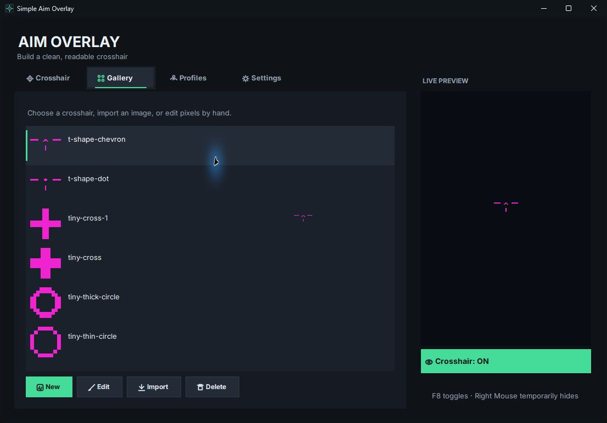

# Simple Aim Overlay

A lightweight, single-file Windows crosshair overlay. Configure its shape, color, outline, opacity, size, thickness, gap, monitor, and position; browse and recolor 20 bundled crosshairs; draw and edit pixel-art crosshairs; import custom images; keep multiple profiles; and toggle visibility with a hotkey or while holding a mouse button or key. Image crosshairs support size, thickness, gap, outline, tint, and opacity adjustments. Closing the window can minimize the app to the system tray.

The interface uses a dark custom control set, English labels, the bundled Inter typeface, and a matching crosshair icon across the app window, taskbar, and tray. Inter is licensed under the SIL Open Font License 1.1; the license is embedded in the app and available at `Assets/Fonts/OFL.txt`.

The overlay is an independent, click-through desktop window. The app does not inject code into games or modify game processes. Visibility in fullscreen depends on Windows, the graphics driver, the game, and its fullscreen presentation mode.

## Install and update

Download the single **Setup.exe** from [Releases](https://github.com/vvoldi/SimpleAimOverlay/releases/latest). Close the running app using Exit in the tray, run Setup, and approve the Windows administrator prompt.

On first installation, Setup asks for consent to trust the bundled public test certificate and installs the app under Program Files. Only install this package if you trust its publisher. Windows may show an unknown-publisher or SmartScreen warning: self-signing does not remove these warnings.

Updates use the same signing certificate and preserve local settings. Setup checks the certificate thumbprint and does not add another certificate when it is already trusted. The administrator prompt can still appear on updates. If the certificate expires or changes, trust must be established again.

Existing friend-test installations use the same installation directory and settings. Uninstall is available through Windows Installed apps; it also removes the test certificate.

## Requirements

- Windows x64
- .NET 10 SDK to build from source

## Build

Build a normal single-file executable:

```powershell
dotnet publish -c Release -r win-x64 --self-contained true `
  -p:PublishSingleFile=true `
  -p:IncludeNativeLibrariesForSelfExtract=true
```

The output is `bin\Release\net10.0-windows\win-x64\publish\SimpleAimOverlay.exe`.

To build the UIAccess variant, add `-p:UseUiAccess=true`. Windows grants UIAccess only to an Authenticode-signed executable whose signature chains to a trusted certificate and which runs from a protected location such as `Program Files`. A local build by itself will not meet those requirements. See [Microsoft's UIAccess requirements](https://learn.microsoft.com/en-us/windows/win32/winauto/uiauto-securityoverview).

GitHub Actions produces an unsigned build artifact for compilation checks. Installable releases are built locally with the existing self-signed certificate using scripts/Build-SelfSignedRelease.ps1. The private signing key is never stored in this repository or shipped with the installer.

## Data and privacy

Settings and imported crosshair images are stored locally under `%LOCALAPPDATA%\SimpleAimOverlay`. The app does not require an account or network connection.

## License

This project is licensed under the MIT License. See [LICENSE](LICENSE).

## Code signing policy

Releases use a self-signed certificate and explicit local trust, not a publicly trusted publisher certificate. See [CODE_SIGNING_POLICY.md](CODE_SIGNING_POLICY.md).

## Screenshots




